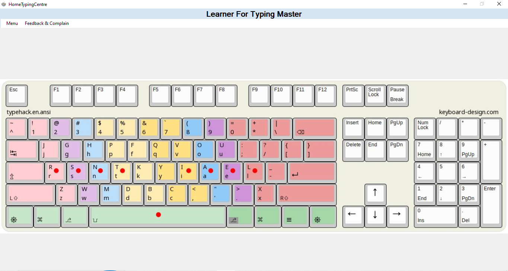
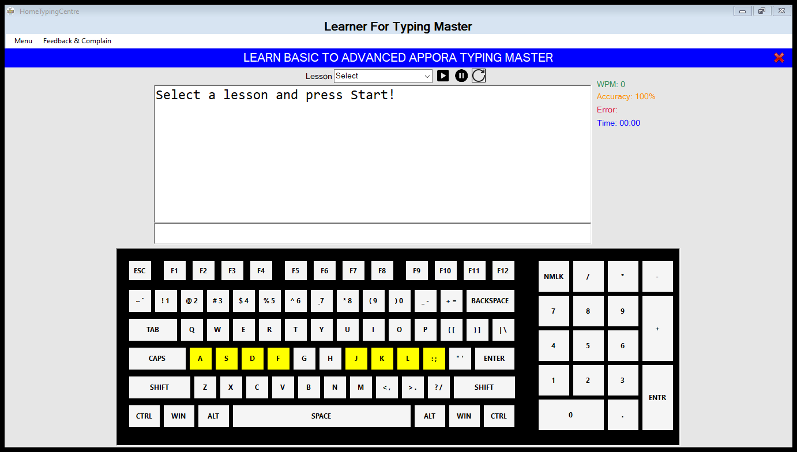
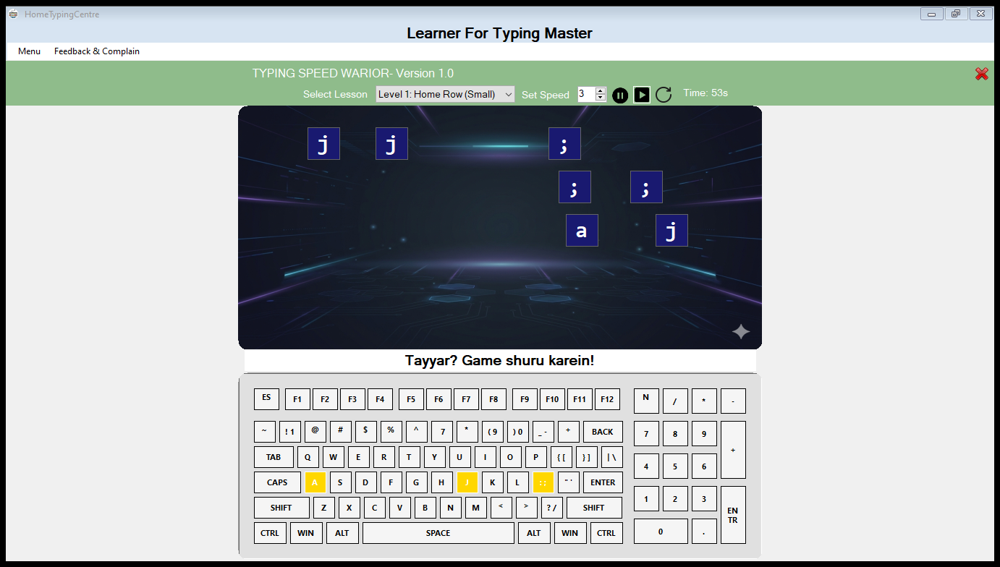
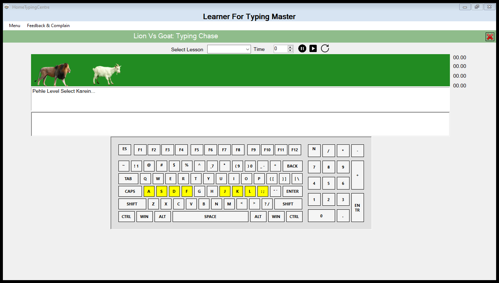
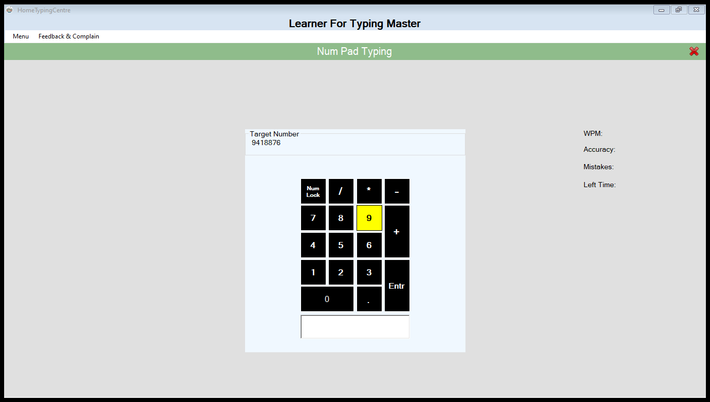

# Appora Typing Master — Typing Tutor

A fast and practical Windows desktop typing tutor designed to improve touch typing speed (WPM), accuracy, and keyboard skills.

## Visual Tutorial & Features

### 1. Main Screen & Dashboard

### 2. Learn Basic to Advanced appora typing master

### 3. Typing Speed Warior

### 4. lion vs goat typing game

### 5. NumPad Typing Practice

## Download
Get the Windows release from [GitHub Releases (v1.1.0)](https://github.com/apporasoftware/apporasoftware.github.io/releases/tag/v1.1.0).
